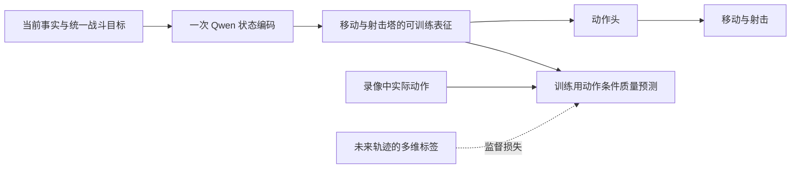

# 细粒度反馈、统一推理目标与 Jev 训练路线

2026-11-25，研究与设计稿。基于本次重新下载的 TerraBlind、TypeSafe、Laya 源码/文档及 DPO/AWR 原论文摘要。本文更新前一轮 [多维质量方案](COMBAT_MULTI_OBJECTIVE_LABEL_PROPOSAL.md)：质量不再只取 positive/negative/unknown，而采用原始测量、有序等级及独立证据掩码。尚未修改训练实现或启动新实验。

同日完整仓库补充：已核对 main 与 README 推荐的 dev/agent。Jev 战斗之外有独立 PPO 移动实验；dev 另加入攻击状态反馈与更丰富的联合战斗关系。固定源码、迁移映射与以撒实际录像输入预览见 [TERRABLIND_ISAAC_TRANSFER.md](TERRABLIND_ISAAC_TRANSFER.md)。

## 一份推理输入可以对应多种训练监督

需要区分三件事：

1. **输入中的目标**：希望安全、有效地推进当前战斗；在训练与推理保持一致。
2. **训练标签**：这次行为实际造成多少伤害、规避得如何、是否改善攻击位置、是否依赖极限微操。它们可以有多个维度、有序等级和连续数值。
3. **输出动作**：仍然是移动与射击，实时执行不需要知道未来结果。

现有数据把观察到的结果 condition 写入训练 prompt 和 numeric，部署固定 positive。这是结果条件模仿，并非把结果作为预测目标。扩大 condition 的类别，还会产生部署该要求哪一种、目标组合是否见过的问题。建议下一轮将实际结果移到损失侧，而不是要求推理输入“躲弹=4、输出=4、换位=4”等未来结果。

统一目标不等于每项都必须满分：没有迫近弹幕时，躲弹轴不适用；需要规避时，短暂没有命中仍可合理；攻击位置安全有效时，停留可合理。不同局面要求由状态与能力事实决定。

原 positive/negative 仍可保留为历史审计字段，但不再作为新方案的实际结果条件输入。只有用户真正要求不同战术偏好时，才增加目标条件，并用覆盖这些偏好的数据训练。

## TerraBlind 本次核对

| 部分 | 本次源码/文档证据 | 对本项目的意义 |
| --- | --- | --- |
| 战斗请求 | `Dodge.Body()` 请求 `jev-latest`，`state + questions.action`，问题为 `choice` | 一个固定选择目标可以利用丰富状态与候选描述 |
| 选择原则 | 请求中解释恒速接触预测的假设、保持退路、避免进入另一威胁、动作幅度与工具、动作持续至下次回答 | 注入简短机制与决策语义；保持估计假设可见 |
| 高阶事实 | `DecisionFacts.State/Describe()` 输出接触伤害占玩家 HP 的比例、接触时间、相对位置、近期速度、四侧空间与候选路线关系 | 脚本做计算，模型比较关系；不必逐个武器优化 |
| 特定知识 | `FieldBooks()` 注入当前 Boss 的说明 | 可借鉴机制说明格式；本项目优先共享能力与通用战况，不照搬逐 Boss 编写打法 |
| 攻击 | `ProjectileAim.TryAttack()` 调用可攻击判断、拦截瞄准并按住攻击 | 演示的攻击效果包含脚本贡献，不能归为模型学会全部战斗 |
| DPS/受伤 | `TrackDps()` 与 `Hurt()` 记录近期 Boss HP 变化、历史中位数比例和伤害诊断 | 是观测/日志，源码未把这些记录用于梯度训练；总 HP 差也有实体消失/阶段变化的归因局限 |
| `JevPrior` | 保存选择计数，用于随机对照采样 | 不是在线强化学习 |
| TypeSafe 训练 | 官方 AI primer 称 Jev 用 RLCD 训练受约束决策与校准概率 | 本次资料未给出可复现的完整后端训练算法；不能声称复刻其训练 |
| TypeSafe `Score` | 有序、带文字说明的等级，输出等级概率及期望分；同一 `state` 可有多个问题 | 多维/非二元监督与一次请求并不矛盾；这是 API 能力，不证明 TerraBlind 用 Score 训练战斗 |

TerraBlind 的战斗调用没有传 positive/negative 轨迹条件。我们的冻结 Qwen + 自训动作头，与调用一个已后训练过的通用 Jev 服务是不同起点。仅模仿其 prompt 不保证获得相同能力。

## 细粒度标签的具体形式

每条行为片段保留三层数据，避免用一个总分覆盖相互冲突的质量。

### 原始事实

保存伤害量与来源、窗口有效时长、敌方可信 HP 变化、攻击机会变化、危害轨迹余量、改向依赖和证据完整性。连续值有意义时直接保留；无伤事实不强行细分成五个虚构等级。

### 语义质量轴

规避、建立攻击机会、攻击有效性、输出效率和可复现性可采用 **0–4 有序等级**，每轴单独定义锚点。例如“建立攻击机会”的讨论用锚点：

| 等级 | 含义 |
| --- | --- |
| 0 | 持续无效攻击且没有调整；机会与机制证据充分 |
| 1 | 有动作但未改善攻击通道，持续缺乏进展 |
| 2 | 合理等待或换位准备，尚未形成可确认进展 |
| 3 | 建立或维持有效攻击机会，并有可信进展 |
| 4 | 持续利用攻击机会、准备耗时较少，且有宽裕执行余量 |

这些是准备人工审计和验证的锚点，不是已经校准的自动判定规则。边界模糊可给邻近等级的软分布；证据不足为 unknown/masked，没有该威胁为 not_applicable。unknown 不能等同于中间等级 2。0–4 的序关系也不自动代表等距效用。

输出效率使用可比战况参照，规避要求先存在需要处理的威胁，安全性保留独立伤害事实。高输出不将危险移动改成优质移动。合理蓄力、无敌阶段和绕障准备不因短窗口没命中被归为最低等级。

### 动作偏好

若同一状态下存在多个经验证的合理动作，可监督一个动作分布，或记录动作对的偏好与平局。柔化标签需要真实支持：不能凭一条人工动作，给其余 44 个动作编造结果，也不能只做均匀 label smoothing 后就称模型学会多种正确策略。

质量等级的软分布，与动作选择的软分布是不同目标。前者描述证据与等级不确定性，后者描述多个动作是否值得选择；都不是未经校准的生存/命中概率。

## 推荐训练路线

### 阶段一：同目标监督训练与质量辅助任务

先保留 E08 双塔，训练/部署采用同一个目标和共享输入生成器。动作模仿按移动/射击分支的证据等级与可复现性加权，保留有效站射、主动绕行、Boss 房和受伤片段中仍有效的分支。

增加训练用的动作条件质量预测器 `g(state, observed_action)`：用同一次 Qwen 编码及小型动作嵌入预测多个质量轴的有序分布/数值。损失使用掩码、证据权重，等级采用有序损失或软交叉熵，连续测量使用相应回归损失。动作头与辅助任务若共享可训练表征，才可能通过辅助梯度帮助动作学习；单独训练一个与动作头完全分离的评分器不会自动改变策略。

辅助质量监督来自行为片段，记录后续改向等关联不确定性，不宣称单个按键的因果效果。它预测的是数据中的后续行为质量关联，不能直接称为所有候选的真实 Q 值。

部署只走状态到动作的路径；质量预测器可用于诊断，第一轮不靠它重排未知候选，也不由脚本拦截动作。质量辅助任务不是必然有效，须与仅质量权重的动作训练单独对照。

严格说，这是分类策略的监督微调与多任务学习。当前冻结 Qwen 时，权重更新只发生在头/表征中。如果要让 Qwen 本身学习“能力说明→战术关系”，可以另做小规模 LoRA 对照；它需在线重算主干特征、验证训练显存与推理时延，不能继续复用冻结特征缓存当作已微调主干。

### 阶段二：用现有轨迹比较优势加权

优先比较 AWR 思路，而非立刻要求 DPO 数据。AWR 原论文使用两个监督步骤：价值回归，以及按优势加权的动作回归；支持离散动作和已有轨迹。

将原始多维结果保留用于审计，再根据统一战斗目标定义可检查的回报/约束，训练 `V(state)`，计算回报相对相似局面预期的优势。困难战况中合理规避与换位，不因绝对 DPS 较低而被简单当成坏示范。

典型 actor 权重为 `clip(exp((G - V(state)) / temperature), upper_bound)`，再乘证据/适用性权重；这里 `G` 必须是与动作时序对齐的片段/轨迹回报，不能把“60 帧内任意一次命中”的布尔量机械重复奖励给每一帧。单个威胁度过/一次命中限制总信用，避免重叠窗口膨胀；过程进展可用经过验证的势差设计，避免来回走位刷“距离改善”。

价值估计误差会改变优势，必须按整局分组验证，并与直接质量加权 BC 对照。离线数据缺少策略未见动作的真实结果，AWR 不能保证教出示范从未出现的主动战术。采用示范锚定、权重截断和固定输入，限制训练偏离数据支持；是否有效依靠闭环测试，而不是只看训练回报。

### 阶段三：具备可靠偏好时比较 DPO 式策略损失

DPO 通过同一输入下 chosen/rejected 的相对策略概率、相对于参考策略的比值学习偏好。对于当前双分支，可将联合动作概率写为 `pi(move|state) * pi(shoot|state)`，针对固定状态的真实动作对训练相对偏好。独立分支仍有组合表达限制；如暴露出移动/射击不协调，再比较联合 45 类或共享候选评分头，且只编码状态一次。

需要同状态或经过严格控制可比性的真实反馈/人工判断。不同房间、不同阶段的两个片段不能随意配成“高 DPS chosen / 低 DPS rejected”。短轨迹偏好需要专门定义序列概率与状态演化，不能直接丢给文本 DPO trainer。几何估计可提供弱证据，但不能冒充已运行替代动作的结果。

没有可靠动作对时，保持 AWR/质量加权训练，不捏造偏好对。后续可采集模型失误状态的人类纠正、相同战况的受控比较，再决定是否引入偏好损失。SFT 锚定或参考策略约束用于限制分布坍缩，并非保证安全。

真正的在线 PPO/其他 RL 留作后续独立阶段：需真实策略交互、可靠回报、策略概率与动作执行对齐、可重复测试。给现有数据加分或加权，不等于已经做过在线强化学习。当前无需逐武器重建奖励规则，也无需改掉“运行时脚本只提供事实”的约束。

## 与 RLCD / Laya 的关系

TypeSafe 官方说明将 RLCD 定义为训练结构化决策与校准概率，并非这里具体的游戏回报算法。

Laya 公开 `train.py` 的 `soft_ce_loss()` 针对目标分布训练；`rlcd_loss()` 给 detached logits 加高斯噪声，用 `proper_reward` 与目标分布比较，按标准化优势训练 log-density，再加 soft CE。代码还记载一个 typed-decisions 对照中额外项没有收益。这是 Laya 的实现，不能声称为 TypeSafe 完整算法。

可借鉴软目标、多维问题、有序等级、独立校准集和候选顺序增强，但噪声 logits 上的评分不等于在游戏里采样多个动作、观察躲避和 DPS 后进行 RL。动作选择频率与成功概率始终分开；只有针对清楚定义的结果任务、用独立结果标签检验后，才能讨论相应概率校准。

## 下一轮最小实验

先完成标签覆盖率/等级边界/归因审计，以及共享语义输入的部署一致性预检。采用同一输入、架构、整局划分和训练预算比较：

| 组别 | 训练变化 | 目的 |
| --- | --- | --- |
| A | 原结果条件模仿 | 基线；维持自身原契约 |
| B | 固定期望条件 + 细粒度分支质量权重 | 检验监督方案整体变化 |
| C | B + 训练用多维质量辅助任务 | 检验辅助表征收益 |
| D | B 的监督初始化 + 价值回归/优势加权阶段 | 检验相对战况评价是否优于直接权重 |

A/B 的 prompt 内容因目标条件不同，需要独立匹配缓存，不能声称只改了损失。C/D 的附加训练匹配总更新预算，并报告阶段成本。若已有上一轮交叉对照结果，则复用其可验证基线，避免重复训练。DPO 与 LoRA 只在对应数据/假设需要时另开组，不同时混入第一轮。

保留每轮头，按验证集选候选，不从测试集反推等级和权重。最终以闭环 HP 损失、存活/清房率、清房时间、长期无进展、有效攻击、输入实际生效覆盖及新能力组合表现验收；不以“不移动比例越低越好”选模型。

## 来源

本次源文件与哈希缓存于 `.local/research/jev-labels-20261125/sources.json`，属于研究材料，不是训练输入。

- [TerraBlind Dodge.cs](https://github.com/Reisenbug/TerraBlind/blob/main/Jev/Fight/Dodge.cs)，请求约 460 行，DPS 约 285 行。
- [DecisionFacts.cs](https://github.com/Reisenbug/TerraBlind/blob/main/Jev/Port/DecisionFacts.cs)，状态与路线描述。
- [ProjectileAim.cs](https://github.com/Reisenbug/TerraBlind/blob/main/Jev/Port/ProjectileAim.cs)，脚本攻击。
- [JevPrior.cs](https://github.com/Reisenbug/TerraBlind/blob/main/Jev/Fight/JevPrior.cs)，对照组计数。
- [TypeSafe AI primer](https://docs.typesafe.ai/introduction/machine-learning-primer)、[Score](https://docs.typesafe.ai/primitives/score)、[Choice](https://docs.typesafe.ai/primitives/choice)、[Composite scoring](https://docs.typesafe.ai/patterns/composite-scoring)。
- [Laya train.py](https://github.com/NandhaKishorM/laya/blob/main/laya/train.py)，`soft_ce_loss` / `rlcd_loss`。
- [DPO 原论文](https://arxiv.org/abs/2305.18290)：Direct Preference Optimization: Your Language Model is Secretly a Reward Model。
- [AWR 原论文](https://arxiv.org/abs/1910.00177)：Advantage-Weighted Regression: Simple and Scalable Off-Policy Reinforcement Learning。
