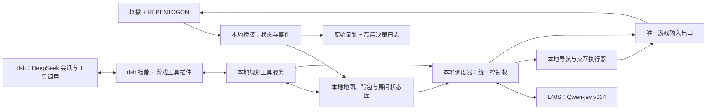

# DeepSeek / dsh 高层规划接入草案

2026-11-24。供用户调整，尚未接入 API、安装插件或修改运行中的游戏/模型服务。

用户已确认 v004 能实际清理一个房间。当前战斗推理部署在 L40S，电脑运行游戏、状态桥和动作执行。首个高层闭环目标是自主选择房间、正常走门、战斗、处理掉落、选择免费道具，然后继续探索。

## 1. 系统分工



| 组件 | 职责 |
| --- | --- |
| DeepSeek | 比较路线、道具和资源，选择高层目标，给出简短理由 |
| dsh | 管理对话、技能上下文、工具调用循环，以及它原生支持的上下文整理 |
| 本地工具服务 | 将完整游戏事实转换成文本/JSON，查询规则知识，生成合法高层选项，接受计划 |
| 本地调度器 | 维护自动游玩会话；触发规划；切换战斗/导航；处理暂停与人工接管 |
| 本地导航器 | 楼层图寻路、房内网格寻路、碰撞避让、正常按键移动、拾取/按钮等交互 |
| Qwen-jev | 战斗中的移动和射击，继续使用当前 v004 输入与权重 |

整个控制循环以本地调度器为主。高层 API 的等待、工具查询和长思考均异步进行，游戏回调只处理本地已准备好的输入。

## 2. dsh 的接入方式

本机存在 `C:\Users\11691\.dsh`，其中有 skills 目录和 desktop profile；profile 的 package.json 声明 `@deepseek-ai/dsh-base` 与 `@deepseek-ai/dsh-web-app`。尚未核实该安装版本的插件工具注册、MCP、事件唤醒或无人值守会话接口。

建议把接入拆为两部分：

- 技能：`isaac-planner`，描述游戏目标、信息读取顺序、决策规则、工具调用方法、暂停/接管的含义。
- 插件：`isaac-tools`，向 dsh 注册一组游戏工具，将调用转发到本地规划服务。

技能负责指导如何玩；实际的数据读取与动作执行由插件/工具服务实现。插件可以采用 dsh 原生工具注册；如果当前版本支持 MCP，则同一组接口可以再包装为 MCP。工具服务以普通本地接口为基础，使导航、录制和控制权不依赖某个 agent 框架。

dsh 默认管理 DeepSeek provider、消息历史和工具调用。项目无需再重复实现一套完整 LLM agent 框架。实际插件格式、安装命令、模型名和 provider 配置在确认 dsh 版本后落实，不在草案中假定某个未核实的 SDK API。

建议只有一个规划会话。一次房间任务结束后继续同一会话，保留当前路线、背包与最近事件；游戏事实以本地状态库为准，每次决策获取新快照。框架的对话总结只保存战略记忆，不能替代实时地图或资源数值。

## 3. 给 DeepSeek 的信息

高层默认读取完整已知楼层地图、完整当前装备清单、当前房间全部目标与合法选项。细节可以通过批量工具继续读取。原始游戏状态仍完整保存，文本摘要不影响后续重新处理数据。

| 信息组 | 内容 |
| --- | --- |
| 游戏与角色 | 游戏/模组版本、模式、角色、所在楼层、当前维度、诅咒、计时、当前目标 |
| 生命与资源 | 红/魂/黑/骨心、血量上限、金币、钥匙、炸弹、主动槽充能、卡牌/药丸及其已知效果 |
| 属性 | 当前伤害、射速、移动速度、弹速、射程相关字段、幸运、飞行、攻击形式和特殊泪弹效果；标明单位与换算来源 |
| 背包 | 每件被动道具的 ID、名称、数量、主要效果；主动槽、饰品、口袋物品；已知组合、重要副作用 |
| 地图 | 房间节点、形状/占用格、门连接、地图可见性、已访问/已清理、可回访、已知掉落/道具、未探索方向 |
| 当前房间 | 房间类型、门及锁状态、所有拾取物、价格、选项互斥组、箱子/按钮/楼梯/机器、障碍和残留危险 |
| 游戏规则 | 通用基础规则；与当前选择相关的道具、门、商店、交易、隐藏房等详细规则 |
| 近期结果 | 上个房间耗时与掉血、上个目标是否完成、拿了什么、消耗了什么、卡路/失败原因、最近规划意图 |
| 战斗能力 | 当前 v004 支持的控制方式、近期战斗表现，以及某个新道具是否改变控制语义 |

DeepSeek 不需要在每个战斗逻辑帧收到所有子弹坐标；战斗由 Jev 接管。高层可以按需查看完整房间实体，以及清房总结和残留危险。

**地图同时提供字符图与结构化图。** 字符图便于理解，房间 ID 和边列表用于可靠选目标。例如下面仅为格式示意：

```text
             [B:r_boss]
                  |
[T:r_treasure]--[@:r_current]--[?:r_unexplored]
                  |
             [S:r_shop]

@ 当前房间；T 宝箱房；B Boss 房；S 商店；? 已看见但未探索
每个节点同时附 visited / clear / door_cost / known_loot。
```

大房间和 L 形房间采用实际房间形状及门槽，维度分开维护。图的连接不能仅通过地图索引加减固定偏移推断。

建议默认使用玩家当前可知的地图、道具和药丸信息；未知内容明确标 unknown，隐藏房候选明确标 inferred。可另设研究用的全图/完整引擎信息开关，对照不同信息条件。开关属于实验配置，默认工具输出保持同一信息档案。

**道具效果需要补充知识库。** 当前 mod 的 ItemConfig 名称/Description 通常只是游戏里的短文案，并不等于完整效果。计划建立版本化的本地条目：`ID、名称、类型、品质、主要效果、触发条件、副作用、组合、当前战斗控制兼容性、来源、版本`。可参考 External Item Descriptions 等资料后核对 Repentance+ 版本，并逐步补充。

每次出现新道具时批量获取其完整条目，并结合全部当前装备做比较。实际属性以引擎读数为准；对“拿到后会怎样”的预测标注依据和不确定性，不将预测数值写成已发生的事实。

## 4. 状态采集需要补齐的地方

当前已经有位置/速度/血量、基础属性、当前主动、背包、当前房间地形、门位置及开闭、拾取物类型/子类型/价格，以及房间/战斗事件。以下为新增采集目标，尚未实现：

1. 完整楼层房间图：RoomDescriptor、维度、形状、可见/已访问标记、实际门连接、房间记忆。
2. 门的目标房间标识与通行条件，目前仅有 target_room_type 等局部字段。
3. 拾取物细分、价格语义、OptionsPickupIndex 等互斥选择、箱子状态、可拾取条件、盲道具/诅咒可见性。
4. 更多属性、攻击形式、完整主动槽、饰品/卡牌/药丸知识状态。
5. 控制/路径完成事件与道具实际获取结果，供高层读取。

当前背包缓存只在 GetCollectibleCount 变化时刷新。主动一换一、道具重掷等情况可能保持总数量不变；新增高层背包快照需要在拾取、丢弃、重掷、主动槽变化、进房/规划时刷新和核对真实 ID/数量。

完整地图/道具知识采用进房、进层、装备/资源变化等事件更新及必要的定期核对，避免每帧扫描并传输整个百科。

## 5. 工具接口草案

以下名称为拟定接口，尚未注册到 dsh：

| 工具 | 参数示意 | 作用 |
| --- | --- | --- |
| `observe_game` | `detail, since_version` | 一次读取角色、资源、地图摘要、房间目标、执行状态和近期事件；支持完整查询 |
| `get_floor_map` | `format` | 返回完整已知字符地图和房间图，标注未探索方向和路线条件 |
| `get_room_details` | `room_id` | 当前房间完整数据，或已访问房间最后记录的内容及记录时间 |
| `get_item_details` | `item_ids[]` | 批量返回道具效果、组合和战斗控制兼容性 |
| `get_rules` | `topics[]` | 返回当前版本的规则条目 |
| `get_available_actions` | `decision_id` | 列出此时真正可执行的高层动作、目标、成本与结果约束 |
| `execute_plan` | `decision_id, action_id, wait_until` | 提交目标，由本地导航/交互/战斗完成；可等待下一次规划窗口 |
| `get_execution_status` | `task_id` | 查询完成、被战斗打断、无法到达、目标消失等状态 |
| `wait_for_decision` | `event_cursor, timeout_s` | 异步等待清房/进房/新选择/失败等事件，附最新快照 |
| `stop_autoplay` | — | 清除所有自动目标和输入，回人工 |

`execute_plan` 的高层动作类型建议为：

- `enter_door` / `visit_room`：进当前门，或沿已知路线去某个房间。
- `collect_pickup`：普通掉落或免费道具。
- `press_button`：去踩指定按钮；若触发敌人，立即交接战斗。
- `skip_pickup` / `defer_pickup`：跳过或稍后回访某个物品，并更新规划记忆。
- `next_floor`：走到已出现的楼梯/出口正常进入下一层。
- 后续扩展 `buy_pickup`、`open_chest`、`search_secret`、`use_active`、`use_card_or_pill`。

高层选项数量随房间变化，例如最多 8 个门，加全部可交互目标、合理回访目标和等待/结束意图；不采用固定 45 类头。代码按可达性、通行/资源条件和互斥组生成选项，DeepSeek 负责比较价值和选择。提供完整候选，特别拥挤时分页或按类型查询。

示意选项：

```json
{
  "decision_id": "decision-17",
  "action_id": "enter-west-door",
  "kind": "enter_door",
  "target_id": "door-left0",
  "destination_room": "room-treasure",
  "destination_known_type": "treasure",
  "cost": {"keys": 1},
  "reachable": true,
  "expected_result": "enter_destination_room"
}
```

初版一次提交一个主目标，可附一两句理由与后续意图。后续支持最多几步的计划，并在每一步重新检查执行条件。

## 6. 实际执行与控制交接

调度状态建议为 `MANUAL → PLANNING_WAIT → NAVIGATION → COMBAT → PLANNING_WAIT`，另有 `TRANSITION / PAUSED / DEAD / BLOCKED`。

1. 开始自动游玩：采集新快照，dsh 加载技能并读取当前目标。
2. DeepSeek 按需查询地图/道具/规则，选择合法目标并调用 execute_plan。
3. 本地执行器验证目标，使用楼层图 + 房内网格规划路线，通过正常移动输入走门/拾取/踩按钮。
4. 新房间出现敌人/敌方弹幕，撤销导航输入，交给 L40S Jev。
5. 敌人与敌方弹幕消失并稳定若干逻辑帧后，返回规划窗口，附清房与掉落总结。
6. DeepSeek 处理新选择，或沿仍有效的计划继续。

规划窗口初始稳定阈值建议 6 个逻辑帧（约 200 ms，待实测）。地面伤害、炸弹、激光等另由危险层判定和导航避让；当前战斗分类只有敌人/敌方弹幕，不能单靠 room.clear 或现有 combat_ended 标记认定导航路径安全。

本地导航器使用碰撞网格和路径跟踪，考虑角色碰撞半径、飞行、障碍、门是否打开、路径上的危险，避免穿对角墙角。每次短移动后根据真实位置纠正；站到门口、站到道具附近均不等于任务完成。

完成判据用游戏事实：过门后目标房间匹配；拾取后实体/背包/资源发生预期变化；踩按钮后按钮状态改变；进层后楼层身份更新。卡住时本地重寻路，仍失败则返回 blocked 和原因让 DeepSeek 重选。

**统一输入出口是必要改造。** 当前 remote-infer 自己 set_mode，并在结束时切回 manual。完整模式会将它的构造观测/调用 L40S/解析动作抽为一个组件，由调度器管理模式和输入；独立 30 秒 AI 启动器保留为单独测试入口。

规划器提交目标，导航器与战斗组件输出短动作，只有调度器可以提交游戏输入。控制交接递增 control_epoch，撤销上个控制者的动作/目标。F8、暂停和死亡撤销整个自动会话；旧 LLM 返回、旧工具任务和旧模型结果均不能重新开启自动控制。人工接管后需要显式重新启动/恢复。

## 7. 高层与低层分别校验状态有效性

低层继续使用原观测帧和 6 帧有效期，过期结果丢弃。高层 API 返回需要几秒时，采用语义上的 decision_id/候选版本，而不是把每个新游戏帧都视为新的决策版本。

高层目标携带运行会话、楼层/维度、房间访问身份、decision_id、目标 ID 和资源条件。新房间、新选择、拿取/重掷、资源不足、暂停/接管等重要变化会使候选过期。若目标仍可执行，本地移动每次都基于最新帧；若无法执行，返回结构化原因和新选项。

现有 run_id 用种子做训练分组，同种子重开可能复用。自动游玩另设 run_instance_id/session_epoch，避免重开时继承上一局未完成任务；训练仍可沿用原种子分组方式。

## 8. Agent 等待与上下文

主链路采用事件驱动，一次高层目标尽量连续执行到下一个需要选择的时刻。enter_door 的移动完成后，工具服务可以继续等待该房间的 Jev 战斗完成，再向 DeepSeek 返回房间总结和新选项。

长任务的等待方式要符合 dsh 的工具超时：支持异步长工具时等待事件；需要短超时时返回 task_id，再通过有超时的 wait_for_decision 等待。若 dsh 有已核实的事件唤醒接口，可进一步由事件启动后续 agent turn。这里不假定 dsh 已具有某种具体接口。

默认快照覆盖地图和当前装备/选择；规则、道具细节按需批量查询。固定技能和知识条目尽量保持稳定前缀。已查询条目按版本/ID 缓存，变化后失效；缓存是否帮助 DeepSeek API 由实际 provider 指标确认。

初版选择工具调用稳定、响应较快的 DeepSeek 模式。长思考可用于复杂资源权衡，具体模型名和设置以 dsh provider 为准。等待高层时本地维持安全停留；新的敌人/弹幕会优先触发战斗并使当前规划窗口失效。

## 9. 实施阶段与验收

| 阶段 | 范围 | 验收 |
| --- | --- | --- |
| A：只读高层信息 | 地图、完整背包、道具详情、规则、候选；dsh 只解释建议 | 游戏界面与工具文本一致，地图未知信息标注清楚 |
| B：确定性导航 | 不接 LLM，手动指定门/道具/按钮目标 | 普通房、大房、障碍、飞行和目标消失的完成/失败可验证 |
| C：首个完整闭环 | dsh 选门/免费拾取/兼容被动，导航 + Jev 交接 | 连续完成若干房间的进房→战斗→清房→拾取→下一房 |
| D：楼层与资源 | 走到 Boss/出口、回访补血、商店、钥匙箱和交易 | 合法成本、互斥选择、库存变化、失败重规划记录正确 |
| E：更多交互 | 隐藏房探索、炸弹、主动、卡牌/药丸 | 正常输入触发、消耗、实际效果和规划预期可核对 |

第一轮建议普通 Isaac/Normal。当前 Jev 只验证了基本方向移动/射击；改变控制方式的道具标注不兼容/待验证，优先选择数值型被动道具以观察完整闭环。是否限制构筑范围由用户调整。

炸弹/卡牌当前只有人工采集，没有自动输入实现。高层负责这些操作时，需要新增正常输入的单次边沿协议与执行器，不要求把它们加入 Jev 决策头。主动道具已有单次输入通路，但先从安全房间的使用/重掷开始；战斗中即时用道具仍需要本地实时模块支持。

记录高层输入快照、知识版本、工具调用、计划与理由、执行前后事实、路径、模型动作、交接、耗时、掉血、失败和人工接管。战斗训练继续只采用人工控制示范；高层结果日志可用于后续错误分析、偏好或示范学习。

主要指标：目标实际完成率、到达耗时/卡路、无效工具率、交接停顿/旧动作拒绝、规划 API P50/P95 和 tokens、清房及掉血、人工接管次数。HUD 展示当前控制者、下一目标、简短理由与执行状态。

## 10. 待用户调整的默认选择

建议默认：dsh 技能 + 原生游戏工具插件；单个 agent；完整已知地图/背包；未知事实明确标记；先完成普通房间与免费拾取闭环；商店/隐藏房/炸弹/主动分阶段加入；高层阶段事件驱动；F8/暂停停止整个自动会话。

可调整的重点是首个 demo 的目标（若干连续房间/完整一层）、信息范围（玩家可知/研究全图）、道具与构筑范围，以及首期是否包含商店、箱子或隐藏房。dsh 的具体版本/插件接口确认后再把本草案转换成实施清单。

参考：现有 `src/isaac_jev/remote.py`、`bridge.py`、`rooms.py` 与模组 0.3.3；本机 dsh desktop profile；REPENTOGON 1.1.3a 的 RoomDescriptor/GetNeighboringRooms、Dimension、EntityPickup/IsBlind 文档。IsBlind 不覆盖 Curse of the Blind，信息导出需同时处理楼层诅咒。
