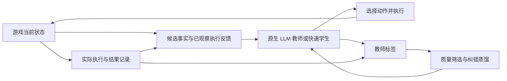

# TerraBlind 候选后果、实时反馈与教师蒸馏

2026-11-25。用户先选择候选描述及实时反馈，再确认用原始动作做无伤优质小数据对齐。V008已完成并挂载；用户随后要求接入高阶反馈、半寻路与主动清敌，V009脚本及30轮配套训练已完成，见[实现记录](FEEDBACK_V009.md)。本文件保留原设计，教师蒸馏及在线强化仍为后续路线。

## 源码中可迁移的两点

固定参考：TerraBlind dev/agent，提交 `6b3b90ed419c91e9741690b551ca4093e2a9206e`。

1. `DecisionFacts.Describe()` 将路线位移、敌方距离变化、弹幕走廊和动作能力写在各候选旁，`Dodge.Body()` 要求在安全选择相近时利用最近攻击状态选择有效射距/射角。这比只列控制名称更利于原生 LLM 比较行动后果。
2. `ProjectileAim.TryAttack()` 检查可用武器、射程/拦截解和攻击路径，输出 `firing` / `no firing solution` 等状态；`Dodge.Facts()` 将 `attack.weapon/last_state` 送回下一次选择。这里的 firing 表示驱动器请求了攻击，不等于已经命中。

TerraBlind 同时由代码瞄准、持续攻击和过滤部分候选。以撒继续采用用户要求的“脚本提供事实、模型选择移动和射击”，优先迁移事实和反馈，不将其脚本控制效果视为 LLM 的全部能力。

## 当前缺口

V007 已有每候选 12 个几何关系和近期同 UID 敌人 HP 变化，但 `last_attack_failure_reason` 在 `features_v007.facts()` 中仍固定为 None。输入中的数值几何与短期进展尚未形成“上一段执行发生了什么、为什么可能没有攻击机会”的明确反馈。

应该分别描述控制生效、物理结果和几何判断，不能把它们压成一个成功/失败标签。

## 建议的反馈结构

| 层次 | 信息 | 证据限制 |
| --- | --- | --- |
| 执行 | 观测身份、动作开始/结束帧、实际生效帧数、是否被替换/过期 | 受理 ACK 不能证明生效；不同动作的片段需按实际控制归属 |
| 移动 | 实际位移、当前速度、路线/地形关系、卡住时长 | “位移小”不自动等于撞墙，需结合控制与几何 |
| 攻击机制 | 按住/释放是否生效、已知充能进度、当前能力与未知值 | 不把释放方向射击统一解释为停止攻击 |
| 攻击机会 | 当前方向的对齐、范围、障碍与穿透关系；可能的受阻原因 | 几何推断标 estimated，复杂武器未知，不冒充实际碰撞事件 |
| 战斗进展 | 可比较敌人 HP 变化、清房事件、已确认受伤、持续无进展时间 | 单纯 HP 差暂缺伤害来源，跟班或旧弹丸可贡献伤害 |

按实际游戏推进帧维护短窗口执行反馈和较长窗口攻击进展，帧缺失、跨房及实体身份变化时保留 unknown。武器射击间隔、弹丸飞行与蓄力影响观察窗口，不能在每个短输入结束时直接标未命中。

模型输入可给：攻击输入已生效、当前通路估计受阻、某时间窗口内没有可确认 HP 下降、有哪些可达攻击位置。由模型结合当前威胁选择是否继续攻击、等待或绕行。

## 候选描述

将每个动作的控制含义和该动作的动态事实邻接组织：位移/通行余量、预计接触与弹幕压力、移动后对可伤害目标的攻击机会、估计窗口及假设。涉及绕障时提供可达攻击位置和路径代价，帮助区分“暂时没有输出的绕行准备”与“长期打墙”。

保留当前危险/低收益候选及未知值，让模型比较；事实脚本不硬选动作。静止、蓄力和合理等待仍可成为有效选择。

## 反馈闭环与蒸馏

实时反馈可以先通过上下文改变下一次决策，不要求每帧更新权重。教师与学生共享相同可观察状态、机制说明、历史反馈和候选定义；教师可以花更多计算，但不使用学生拿不到的未来状态或隐含记忆。

原生 LLM 先通过失败快照检验，再采教师实际执行的数据。生成式延迟需实测：可先离线标注，或建立专用受控训练时钟，不能用新帧号延长旧决策。以撒受控训练若实施，必须推进完整敌人/弹幕/攻击逻辑；TerraBlind 的独立 `tests/Rl` 仅显式调用 Player.Update，不能直接作为完整战斗环境复制。

第一阶段可用教师选择或真实候选概率做蒸馏；LLM 自报置信度不是校准的概率。学生实机出现失误后，请教师在学生实际遇到的状态纠正，逐轮补数据；对真实执行片段采用质量权重，再考虑可靠偏好或小规模强化。未执行的替代动作保持未知，不能沿用原人工轨迹的未来结果为它们赋分。

## 本轮质量数据对齐

先沿用原人工标签和 V007 输入，审计完整房间无伤证据，再保留有进展或合理机制等待、较宽裕走位的片段；训练集限量且按房间平衡，验证/测试划分保持独立。以较好的 S01 初始化，降低学习率微调头并保存每轮权重。这一步用于检验质量小数据对齐，不声称已经实现教师蒸馏、实时反馈模块或强化训练。

相关来源：[候选与反馈请求](https://github.com/Reisenbug/TerraBlind/blob/6b3b90ed419c91e9741690b551ca4093e2a9206e/Jev/Fight/Dodge.cs#L473)、[候选路线描述](https://github.com/Reisenbug/TerraBlind/blob/6b3b90ed419c91e9741690b551ca4093e2a9206e/Jev/Port/DecisionFacts.cs#L76)、[攻击驱动反馈](https://github.com/Reisenbug/TerraBlind/blob/6b3b90ed419c91e9741690b551ca4093e2a9206e/Jev/Port/ProjectileAim.cs#L47)、[独立 RL 环境边界](https://github.com/Reisenbug/TerraBlind/blob/6b3b90ed419c91e9741690b551ca4093e2a9206e/tests/Rl/README.md)。
