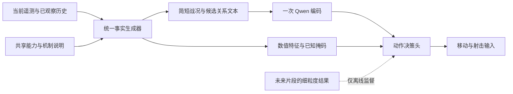

# TerraBlind 源码核对与以撒输入迁移

2026-11-25。已克隆并阅读真实源码，制作以撒录像的离线输入预览。本轮完成参考分析及预览，未更换现有 V004 服务、修改部署特征契约、调用 TypeSafe 或启动训练。

## 仓库与范围

| 参考版本 | 本地目录 | 固定提交 |
| --- | --- | --- |
| main | `.local/references/TerraBlind` | `fac39c763afab11d8beb4657475f6de95634c32c` |
| README 推荐的 dev/agent | `.local/references/TerraBlind-dev`，独立 detached worktree | `6b3b90ed419c91e9741690b551ca4093e2a9206e` |

上游为 MIT，原许可证保留在两份参考目录中。本报告以固定 dev/agent 源码为主要依据；main 的原 Boss 战链路同时核对。设计草稿与已实现代码分开看，视频拍摄时的提交没有定位。

**训练结论需要限定范围**：Jev Boss 战直接调用 TypeSafe `jev-latest`，没有在这条链路训练 Jev；官方后端当然是已训练模型，具体基座与主干冻结方式仍未披露。但整个仓库还有 `tests/Rl/train.py` 的独立 PPO 移动实验，使用 `MlpPolicy` 和 `[64,64]` 网络。这不是 Jev 的训练，也没有接入所核对的 Jev Boss 战。因此此前“整个项目没有训练”说得过宽。

## 模型实际收到什么

Boss 战的请求由 `Jev/Fight/Dodge.cs:473` 的 `Body()` 构建：

```json
{
  "model": "jev-latest",
  "state": "序列化的场景 JSON 字符串",
  "questions": {
    "action": {
      "type": "choice",
      "instructions": "战斗目标、估计假设、动作含义与选择原则",
      "criteria": {
        "某个完整动作的名字": "该动作的路线事实与执行方式说明"
      }
    }
  }
}
```

这是结构示意；从固定源码逐字提取的 instructions 见 [原请求结构](../reports/terrablind-transfer/terrablind-request-shape.json)，其中场景与候选为明确标注的占位符，不是实际 Terraria 采样。

三个部分各司其职：

- **state** 由 `GameSensor.CaptureScene()` 收集原生字段，经 `DecisionFacts.State()` 变成玩家相对位置、危险时间、能力与空间等事实。
- **instructions** 固定解释目标和动作语义，提示估计只假设当前速度保持不变，不代表下一步真的如此。
- **criteria** 由 `ActionCriteria()` 遍历当前可用完整动作，再调用 `DecisionFacts.Describe()`，把路线估计和动作的实际执行方式写在候选上。

请求中没有轨迹 positive/negative 条件。模型返回一个完整动作；脚本负责动作时序、装备可用性、输入和过期回复处理，瞄准与持续攻击也有脚本承担。

## 高阶信息怎么总结

| 信息 | 上游计算/组织方式 | 迁移判断 |
| --- | --- | --- |
| 相对方位 | `(entity.Center-player.Center)/16`，右为正、上为正；字段名直接表达方向 | 可借鉴明确语义与单位；以撒统一 dx 右正、dy 下正，避免混用 |
| 速度 | 多数 `velocity*60/16` 转成格/秒；弹幕额外更新乘 `extraUpdates+1` | 用以撒真实 30Hz 与遥测验证速度单位，不照搬 60Hz 倍数 |
| 相对伤害 | 实体原生 damage 除以玩家当前 HP | 本项目尚缺可靠实体接触伤害量；先标未知，不从 type/HP 猜伤害百分比 |
| 接触时间 | `FramesUntilContact()` 使用相对速度与双方尺寸，按坐标轴估算进入时间 | 需要改成完整相交区间或圆/椭圆扫掠；保留尺寸与运动近似假设 |
| 当前阶段线索 | 敌人 HP 比例、当前速度、近一秒最高速度，配合 Boss 文本解释 | 使用已观测动画/状态/速度变化与机制说明；不把统一 HP 阈值硬套所有以撒敌人 |
| 重要弹幕 | 接近趋势、距离和接触时间筛选，最多 12 条 | 按相关危险与攻击机会筛选，并记录遗漏数量；远处高威胁也不能仅因距离删除 |
| 四侧空间 | 玩家碰撞体至实体地形和世界边界距离，最多展示 60 格 | 复用以撒玩家尺寸、原生房间 mask、L 房空区与火焰等已验证几何 |
| 候选移动 | 完整水平/竖直幅度组合，描述约 0.6 秒位移、敌方距离变化、弹幕通道与预留空间 | 学习“每个动作对应关系摘要”；预测期限必须结合当前动作保持、延迟与惯性 |
| 武器与攻击反馈 | dev 新增 `attack.weapon/last_state`，如 firing / no firing solution / out of reach 等 | 优先迁移：区分缺攻击机会、等待充能、攻击进展不足，给主动换位提供依据 |
| 机制说明 | `BossBook.HowItFights` 在当前场景按需注入，可关闭知识做对照 | 借鉴按需说明与对照；以撒优先共享武器能力/威胁机制，满足用户泛化要求 |

dev 的 instructions 有一句直接关联本项目问题：

> When safe choices are similar, favor a usable firing distance or angle for the current weapon, using the last attack state as feedback.

含义是：**安全选择相近时，结合最近攻击反馈，选择能获得有效射距或射角的位置。** 它不要求永远靠近，也不要求永远移动。

### 不能机械移植的几处估计

`RouteDescription()` 的位移包含固定格数，Boss 按 36 帧当前速度外推；弹幕 corridor 按粗略中心距离计数，0 条叫 clear、1–2 条叫 exposed、更多叫 crowded。这个 clear 是该启发式下的结果，不是完整碰撞判定后的无伤保证。以撒的惯性、短输入、弹幕高度、激光与区域伤害需要不同事实接口。

`FramesUntilContact()` 取两个坐标轴进入时间的最大值，但没有验证另一个轴此时是否已退出，存在误报可能。比如合并半宽/半高均为 5，初始相对位置 `(10,0)`、相对速度 `(-1,2)`：x 到第 5 帧才进入，y 第 2.5 帧已退出，实际不相交，原公式仍可报第 5 帧接触。预览脚本使用另一种圆扫掠估计，并明确圆形尺寸也是近似，不将其称为原生完整物理。

`State()` 对同 Name 威胁只保留最近实体。这对特定 Boss 摘要有用途，但以撒常有多个同种怪，不能照搬；用稳定 UID 跟踪，并保留群体数量及相互位置。

上游缺失最大 HP 时有回退为 100% 的路径。我们的未知信息保留 unknown，不能为了文本完整而填成确定事实。

## 更接近以撒战斗需求的另一条链路

`Flow/PvpDuel.cs` 与 `PvpTactics.Choose()` 不只选择移动：

1. 给移动候选附上路线描述，以及短距离移动后直线射界是 open 还是 blocked。
2. 为当前武器提供可攻击状态、可达距离、弹道飞行时长、穿地形能力与瞄准假设。
3. 组合“移动＋武器＋瞄准/开火”，加入不开火换位候选，从完整计划中选一个。
4. 执行时重算瞄准，检查状态、物品与候选是否仍有效。

其选择原则明确要求边追近边保持可能的远程攻击，遮挡时换位。**这里最值得迁移的是移动与攻击的联合关系**，不是 PvP 的“对手没有接触伤害”原则；以撒敌人接触伤害恰恰必须重视。

`Agent/CombatForecast.cs` 另有把场景复制到隔离运动后端、比较候选轨迹的能力，输出阶段耗时、候选覆盖帧数、预期落地、路线进展、线性威胁重叠、移动后目标关系等。源码明确重叠不是确认伤害，敌方运动仍是假设。这不是训练，也不等于完整世界仿真。以撒没有同等验证的引擎分支后端，第一轮不把该能力当成已经存在。

## 上游脚本也会影响选择和执行

TerraBlind 包含候选过滤、空间预留、不可用工具降级、蜂蜜脱离、边界裁剪以及脚本攻击判定。例如 `GameMovement.AvailableActions()` 过滤动作，`Apply()` 会修改或取消某些请求分量；`ProjectileAim` 也有具体武器机制处理。

这不影响参考其输入设计，但说明演示成绩包含模型、脚本知识和执行辅助。根据本项目已确定的方向，第一轮仅迁移 **事实与描述**：

- 保留所有 9 个移动方向，并报告其风险，不由新脚本删除危险动作或替换模型选择。
- 攻击射界/距离事实用于模型理解，不自动锁敌或替换射击方向。
- 已建立的导航危险避让、输入合法性、人工接管及原观察身份/截止规则继续沿用。

## 以撒建议的输入生成流程



| 新输入部分 | 现有基础 | 下一步需补齐的事实 |
| --- | --- | --- |
| 共享能力 | `weapons.weapon_state()`、冻结道具效果与原生 weapon 数据 | 各字段分别标注来源；触发、传播、障碍/目标穿透、有效作用范围与充能，未知不强填 |
| 即时危险 | `features.py` 的移动近似、`hazards.py`、玩家/实体尺寸 | 相对速度、完整最近接近/进入时间、接触威胁身份；运行中输入、惯性、执行前延迟 |
| 地形与退路 | `terrain.combat_terrain()`、`navigation.py`、已修复火焰几何 | 通道余量、出口关系；通行图与攻击阻挡图分别维护 |
| 当前攻击机会 | E06/E09 的方向/横向偏差/范围估计 | 遮挡类别、攻击能力相容性、目标可伤害性；不能直接对所有武器套普通眼泪直线 |
| 换位后的机会 | 已有 9 方向地形与危险估计 | 移动后射距/射角/遮挡变化；通往有效攻击区域的路径关系，不输出 recommended_action |
| 最近攻击反馈 | 当前已观察 HP、num_fired、holding/charge | 基于过去窗口的稳定 UID 进展、无进展时长、等待/遮挡/射程证据；归因不明保留 unknown |
| 固定目标 | 最新细粒度监督方案 | 训练与部署使用同一目标；实际结果等级留在损失侧 |

格式上用“短能力说明＋少量重点威胁＋动作关系表＋最近反馈”。完整实体、原始地图和推演证据保留在录像/JSON 侧。多种机制共享同一能力接口，由模型比较语义关系，避免逐种武器手工编写战术。

当前 Qwen 主干冻结、通过最后有效 token 的 embedding 训练动作头。新的文本不能直接套到 V004/E08 旧头；须版本化生成器与数值契约，重新提取特征，训练匹配头。先保留 E08 头作输入对照；再单独比较联合 45 类/候选评分设计，避免同时改输入、头和监督无法归因。

## 本轮离线预览已做到什么

新增 [preview_terrablind_transfer.py](../scripts/preview_terrablind_transfer.py)，输入为已有以撒 frame JSON/录像快照，不连接游戏或模型。输出完整审计 JSON 与简短英文文本。

- 复用 V005 的武器、地形、区域危险和历史事实，另计算当前观测速度下的圆扫掠关系。
- 报告目标方向的前向距离/横向偏差，以及玩家中心到目标中心之间的未膨胀格子几何；中间有 pit 不自动等价于攻击被阻挡。
- 将已验证的火焰类型与导航火焰几何作为事实，并保留全部移动选项。
- 不把标签、人工按键、上一动作类别、种子和未来轨迹注入摘要。
- `can_hit_now`、`move_then_attack`、真正攻击失败原因/伤害归因等当前尚不可信的字段保持 unknown。

这是可核对的输入设计样例，**不是已完成迁移或可部署策略**。简短文本限定展示威胁/目标与效果数量；遗漏计数与完整细节留在 JSON。当前保留的移动风险仍有旧版即时换向/固定速度假设，需要下一轮改进，不能将摘要措辞视为精度提升。

| 同一以撒快照 | 原 V005 文本字符 | 新摘要字符 | 字符减少 | V005 构建中位数 | 预览事实构建中位数 |
| --- | ---: | ---: | ---: | ---: | ---: |
| 站定战斗快照 | 5,514 | 3,344 | 39.35% | 4.875 ms | 6.018 ms |
| 清房后仍有火焰的快照 | 4,418 | 2,367 | 46.42% | 1.802 ms | 2.176 ms |

每例预热后交替测量 20 次。本机测量不含模型推理、RPC、文本渲染与文件写入；字符数不是 tokenizer 长度。摘要更短但额外事实计算有成本，尚未证明端到端时延或实机效果改善。

输出与证据：

- [站定战斗输入文本](../reports/terrablind-transfer/isaac-stationary-preview.txt)、[完整 JSON](../reports/terrablind-transfer/isaac-stationary-preview.json)。
- [清房后危险输入文本](../reports/terrablind-transfer/isaac-cleared-room-preview.txt)、[完整 JSON](../reports/terrablind-transfer/isaac-cleared-room-preview.json)。
- [固定源码、哈希与测量](../reports/terrablind-transfer/review-verification.json)。
- [8 项检查](../tests/test_terrablind_preview.py)：进入时间与最近时间区分、横纵投影误报、相对运动不变性、缺失速度、坑与攻击阻挡分离、清房火焰、输入不含未来标签/控制且不改源数据。

## 迁移实施顺序

1. 审计能从现有遥测确认的能力、敌方伤害/接触类型和攻击进展，确定哪些字段可以补采、哪些保持未知。
2. 实现共享事实层：把威胁、通行和攻击关系独立计算；对同一种状态在离线转换与部署生成器核对一致性。
3. 压缩成统一目标文本，核验 tokenizer 长度、构建耗时和状态年龄，不能刷新旧观测时间戳延长决策寿命。
4. 结合 [细粒度监督方案](COMBAT_FINE_FEEDBACK_SFT_REVIEW.md) 做输入/监督的分离对照，保留每轮头和 V004/E08 参照。
5. 闭环比较 HP 损失、清房时间、有效输出、长期无进展、动作覆盖及未见能力组合，单独评价语义输入是否改善泛化。

可把 TypeSafe Jev 作为后续独立模型基线来区分“我们的输入信息不足”和“冻结表征/决策头能力不足”。这需要另行配置服务并核验游戏时延；本轮没有请求该 API，也没有把录像发送到 TypeSafe。

## 固定源码定位

主参考提交均为 `6b3b90ed419c91e9741690b551ca4093e2a9206e`：

- [Dodge：请求与反馈](https://github.com/Reisenbug/TerraBlind/blob/6b3b90ed419c91e9741690b551ca4093e2a9206e/Jev/Fight/Dodge.cs#L473)。
- [DecisionFacts：状态与候选文本](https://github.com/Reisenbug/TerraBlind/blob/6b3b90ed419c91e9741690b551ca4093e2a9206e/Jev/Port/DecisionFacts.cs#L16)。
- [GameSensor：原生感知](https://github.com/Reisenbug/TerraBlind/blob/6b3b90ed419c91e9741690b551ca4093e2a9206e/Jev/Port/GameSensor.cs#L92)。
- [GameMovement：候选与执行](https://github.com/Reisenbug/TerraBlind/blob/6b3b90ed419c91e9741690b551ca4093e2a9206e/Jev/Port/GameMovement.cs#L77)。
- [ProjectileAim：脚本攻击](https://github.com/Reisenbug/TerraBlind/blob/6b3b90ed419c91e9741690b551ca4093e2a9206e/Jev/Port/ProjectileAim.cs#L47)。
- [PvpTactics：联合方案](https://github.com/Reisenbug/TerraBlind/blob/6b3b90ed419c91e9741690b551ca4093e2a9206e/Flow/PvpTactics.cs#L102)。
- [PvpDuel：移动后的射界与武器事实](https://github.com/Reisenbug/TerraBlind/blob/6b3b90ed419c91e9741690b551ca4093e2a9206e/Flow/PvpDuel.cs#L446)。
- [CombatForecast：候选轨迹摘要](https://github.com/Reisenbug/TerraBlind/blob/6b3b90ed419c91e9741690b551ca4093e2a9206e/Agent/CombatForecast.cs#L282)。
- [独立 PPO 实验](https://github.com/Reisenbug/TerraBlind/blob/6b3b90ed419c91e9741690b551ca4093e2a9206e/tests/Rl/README.md)。
