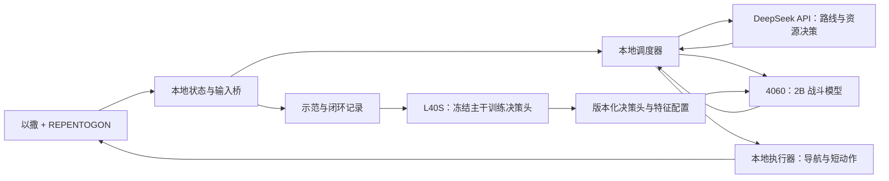

# 以撒完整流程：DeepSeek 高层、本地 Jev 战斗、L40S 训练

日期：2026-11-23。

## 已确定的项目方向

用户提出：DeepSeek API 负责高层决策，本地 2B Jev 风格模型负责实时战斗；本机游玩并展示，记录用户示范，在集群 L40S 上冻结主干训练决策头，再将训练结果部署回本机。

这个分工适合从战斗 Demo 扩展到完整楼层和整局。需要额外的本地调度与执行层，处理模型切换、导航、状态版本和控制权。

本机实际检测结果：**NVIDIA GeForce RTX 4060 Laptop GPU，8188 MiB 显存，驱动 591.74**。当前工作区使用的默认 Python 没有安装 PyTorch/Transformers；尚未安装或测速本地模型。

## 运行架构



战斗控制链路在本机完成，不经过集群。云端高层模型只在需要新计划或资源选择时调用。

## 三个层级的职责

| 层级 | 负责 | 输入 | 输出 |
| --- | --- | --- | --- |
| 高层 DeepSeek | 进哪个门、拿/跳过道具、资源使用、隐藏房候选排序、路线与阶段目标 | 已探索地图、当前房间、血量/资源、可识别道具效果、合法高层候选、计划历史 | 有限类型的高层意图与目标 ID |
| 战斗 Jev | 当前房间的移动、射击和短期规避 | 玩家/敌人位置与速度、投射物、障碍、相关战斗规则、短历史、上一动作、适当的战术目标 | 45 类短时联合动作 |
| 本地调度和执行器 | 控制权、寻路、动作保持/停止、有效期、状态更新、故障和人工接管 | 当前游戏事实、模型返回值和控制状态 | 正常游戏输入与动作执行回执 |

完整高层决策不要求每帧发给 DeepSeek。调用可以由进房、清房、出现道具、计划失败或资源变化触发。

清房后模型选择一个门或拾取物，执行器用房间可走网格寻路并转成移动输入。这个导航器也是完整流程需要实现的一部分。

“房间清空”不必然意味着环境已经安全：仍需检查投射物、炸弹、火焰、尖刺等。如果导航途中出现新的敌人或紧迫威胁，调度器重新进入战斗/避险阶段。

## 隐藏房与信息边界

隐藏房候选先由代码根据已探索的房间图、相邻关系和可炸墙面产生，再让 DeepSeek 结合炸弹数量、生命和当前目标排序。检查已确定的结构约束由代码完成。

不将生成器随机状态、未发现隐藏房的真实坐标或未探索房间的完整内容提供给模型。未知药丸效果、被诅咒遮蔽的道具等同样按玩家当时可知程度导出。

DeepSeek 输出的候选排序可以用于行动选择；输出一个“概率”字段并不自动保证它是校准过的隐藏房概率。

## 控制切换

建议调度状态：

- `HUMAN_RECORD`：你正常游玩，采集状态和实际按键。
- `COMBAT`：本地战斗模型控制移动/射击。
- `MACRO_WAIT`：等待高层决策，同时本地执行器维护安全动作。
- `NAVIGATION`：执行已验证的门/拾取目标，遇到危险可中断。
- `PAUSED` / `DEAD`：停止自动动作，处理暂停或终局。
- `HUMAN_TAKEOVER`：人工即时接管，清除自动命令。

任何时刻只允许一个控制者向游戏提交动作。DeepSeek 的返回值经调度器验证后成为高层目标，不直接与战斗模型竞争按键。

深层计划可以保留，但旧房间目标和旧战斗动作不能跨房间直接继续执行。状态检查必须包含 run、floor、room、frame 与请求版本。

API 请求和本地推理不阻塞游戏回调。输入回调只读取已经准备好的动作。

## 高层接口草案

合法高层动作由代码枚举，模型仅选择其中一项。例如：

- `enter_door(door_id)`
- `collect_pickup(entity_id)`
- `skip_pickup(entity_id)`
- `search_secret(candidate_wall_id)`
- `finish_exploration` 或其他当前真正可执行的阶段动作

模型可以补充短理由用于展示和调试，但执行器只依赖验证过的动作类型和目标 ID。

示意返回值：

```json
{
  "request_id": "macro-41",
  "run_id": "run-8",
  "room_id": "room-17",
  "action": "enter_door",
  "target_id": "door-east",
  "reason": "该方向通向尚未探索的普通房间"
}
```

房间、资源或候选集合改变后，执行器重新核验当前目标。如果不再可执行，停止旧目标并记录原因，必要时重新询问高层。

## 本地战斗模型与 4060

第一版使用 Qwen 2B 级文本主干和 MLP 决策头：9 种移动 × 5 种射击 = 45 类。规则和状态从 mod 导出，不加载视觉编码器。

2B 权重的 FP16/BF16 体积约 4–5 GB，具体取决于模型实际参数和加载部分。8 GB 显存可以作为 batch=1、受控上下文的部署起点；游戏、显示、激活和推理工作区都需要额外空间。

先测试 FP16/BF16，以保持训练和部署表示一致。显存不足时再考虑 8-bit/4-bit；量化后的动作质量和延迟需要重新验证，不能假设量化必然提速。

如果部署使用量化冻结主干，可在集群使用相同量化方式提取训练特征，或者为量化主干重新适配决策头。主干、tokenizer、状态表示、池化位置和数值归一化必须一致。

冻结主干减少训练内存，不会免除本地前向计算。模型进程驻留，推理时关闭不需要的生成过程和输出，优先处理最新状态并避免排队积压。

以撒逻辑更新为 30 Hz。先比较 1–3 个逻辑帧的动作保持策略，并在完整游戏运行时测量端到端延迟和状态年龄。10 Hz 可以作为 3 帧动作块的初始实验频率，不是已经验证的战斗能力。

低延迟指标应包含：采集、通信、tokenization、主干、决策头、回传和输入生效。若要逐逻辑帧产生新决策，整个周期需支持约 33 ms 的预算。

命令具有有限有效期、所属房间和观测帧；超时、换房、暂停、人工接管时明确释放自动动作。

若添加规则避险或自动瞄准，需要明确记录它覆盖模型的时机和比例，分别报告模型与组合系统的结果。

## 用户示范与训练

这里用户说的“决策头校准”首先是**行为克隆/监督微调**：学习在状态下应该执行什么动作。训练后的概率温度校准是另一个可选步骤，用来调整置信度。

本地采集：

- 30 Hz 原始状态与持续移动/射击输入；一次性操作记录触发与释放。
- 原始状态、特征表示、规则版本、run/room/frame、控制模式和上一动作。
- 玩家实际按键、模型建议、执行器实际动作、人工接管以及受伤/清房/死亡事件分别记录。
- 训练战斗头时选择有人类动作标签的战斗片段；模型自身输出不会自动成为正确标签。

在集群 L40S 上：

1. 读取本地采集数据，按 run/房间场景划分训练、验证和测试集。
2. 冻结与本地部署一致的主干，将训练输入转成特征；可以缓存特征，减少多轮训练的重复前向。
3. 用交叉熵训练 MLP 联合动作头，检查类别不平衡和短动作块内变化。
4. 使用固定验证集选择决策头；可选地在独立校准集拟合温度。
5. 导出 head、归一化配置、动作映射、规则/特征版本、主干引用与校验信息。

部署回本地后先做影子预测，再做闭环控制。你在模型失误时接管，记录修正操作，将这些模型实际遇到的状态追加到下一轮训练。

训练可以异步于你游玩进行。本地继续运行一个已经验证的版本，训练结束后显式切换到新版本，不在同一帧里替换一半参数。

仅训练头时不需要每次传回完整主干权重；可只发布决策头及配套配置。若后来训练 LoRA，额外发布 adapter，并在本地验证合并或加载后的速度与动作质量。

## 版本包

```text
combat-policy-v001/
  head.safetensors
  policy_config.json
  normalization.json
  action_map.json
  manifest.json
  evaluation.json
```

`policy_config` 保存主干/tokenizer 修订、dtype/量化模式、最大输入长度、池化方式、历史长度、动作周期、规则与特征版本。推理服务加载时核对一致性，不仅检查头权重能否读入。

## 实施顺序

1. 固定游戏与 REPENTOGON 版本，实机验证状态和输入桥。
2. 录制你正常玩若干种战斗房间，确认时序、字段覆盖和数据完整性。
3. L40S 冻结主干训练首版 45 类头。
4. 在本机 4060 上做游戏同时运行的显存、延迟与影子预测测试。
5. 接通单房间自动战斗，加入人工接管和完整执行记录。
6. 接入 DeepSeek 的门和道具决策，完成“进房 → 战斗 → 清房 → 导航”的楼层闭环。
7. 增加隐藏房搜索、商店、资源与更多战斗机制，逐步扩展到完整整局。

完整整局目标保留，先分别验证各个环节，再逐步衔接。

## 验收

- 确认战斗指令不经过集群。
- 游戏运行时的显存占用、决策延迟 P50/P95、状态年龄和过期指令率。
- 测试场景的清房成功率、受伤、耗时、卡墙、人工接管次数。
- 高层目标执行成功率、候选有效性、路线中断与重新规划结果。
- 新房间/初始化下的泛化，规则控制与模型控制的贡献。
- 画面显示当前高层计划、战斗动作、概率、延迟、版本和人工接管状态。

本次完成架构设计与硬件信息核实。尚未安装模型环境、连接游戏、测速推理、采集数据或提交集群训练。

参考：[isaac_jev_design.md](isaac_jev_design.md)、[terrablind_review.md](terrablind_review.md)、[SocketBridge](https://github.com/EmptyEmeraldTablet/SocketBridge/tree/refactor/v2)、[REPENTOGON](https://github.com/TeamREPENTOGON/REPENTOGON)。
